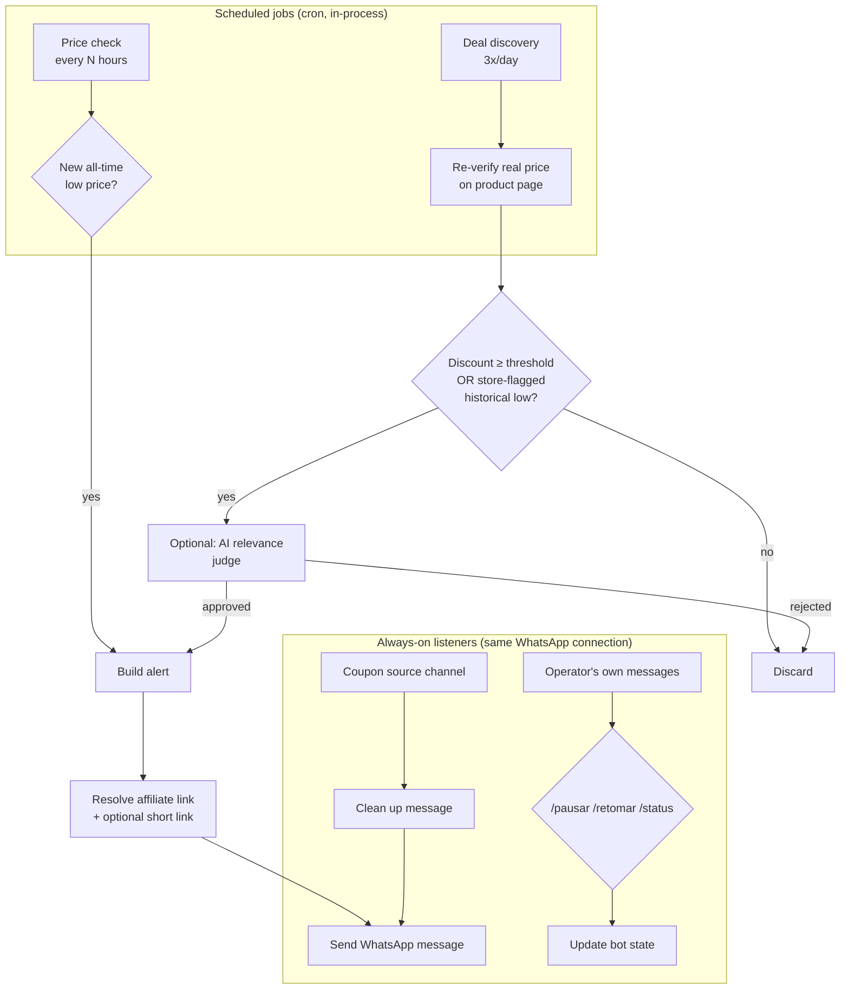

# price-bot

[](https://github.com/matheusbogea74-crypto/price-bot/actions/workflows/ci.yml)
[](https://nodejs.org)
[](LICENSE)
[](https://prettier.io)
[](CONTRIBUTING.md)

**A self-hosted price-tracking bot that watches product prices, detects real discounts, and posts WhatsApp alerts — with an AI gate that filters out "fake" promotions before they ever reach you.**

> This is a personal automation project, published as a reference implementation for anyone who wants to build (or learn from) a similar system. It is built around one operator's own WhatsApp number and store list, not a hosted multi-user service — see [Positioning](#positioning--who-this-is-for) below.

---

## Table of Contents

- [Overview](#overview)
- [Key Features](#key-features)
- [How It Works](#how-it-works)
- [Architecture](#architecture)
- [Tech Stack](#tech-stack)
- [Project Structure](#project-structure)
- [Getting Started](#getting-started)
- [Configuration](#configuration)
- [Usage](#usage)
- [Roadmap](#roadmap)
- [FAQ](#faq)
- [Troubleshooting](#troubleshooting)
- [Positioning / Who This Is For](#positioning--who-this-is-for)
- [Contributing](#contributing)
- [Security](#security)
- [License](#license)

---

## Overview

`price-bot` is a Node.js service that:

1. **Tracks a list of products** across several e-commerce stores and records their price on a schedule.
2. **Detects genuine drops** — specifically, a new _all-time-low_ price for a product, not just "on sale."
3. **Discovers new deals on its own**, by periodically scanning stores' official "deals" pages, re-verifying the price directly on the product page (store deal badges are not trusted blindly), and optionally asking an LLM whether the deal is actually worth showing a human ("is this a real, sensible opportunity, or discount-badge noise?").
4. **Publishes alerts to WhatsApp** — as rich messages (image + price comparison + affiliate link) — either for a tracked product hitting a new low, or for a freshly discovered deal.
5. **Forwards curated coupon messages** from a source WhatsApp channel, cleaned up into a consumer-facing format.
6. **Accepts remote control commands** (pause / resume / status) from WhatsApp itself, so the operator can manage it without SSH access.

It was built to solve a concrete, personal problem — "tell me when something I actually want to buy is genuinely cheap, without me babysitting price tags" — and is published here as a working reference for the pattern: **scheduled scraping → historical-price comparison → LLM-assisted relevance filtering → messaging-platform delivery**, which generalizes well beyond price tracking.

## Key Features

- 📉 **Historical-low detection** — a "sale" only triggers an alert if it beats every price ever recorded for that product, not an arbitrary percentage off an inflated "was" price.
- 🔍 **Autonomous deal discovery** — scans store-provided deal feeds, re-scrapes the real price to confirm the discount is real, and only then evaluates it.
- 🤖 **Optional AI relevance gate** — a small LLM call judges whether a deal is the kind of thing worth interrupting someone's day for (popular, sensible category, plausible discount) versus technically-qualifying noise. Fails open (never blocks a deal) if unconfigured or unavailable, so it's a pure quality improvement, never a hard dependency.
- 💬 **WhatsApp-native delivery** — no separate app, dashboard, or push-notification setup; alerts arrive exactly where the operator already reads messages.
- 🎟️ **Coupon channel relay** — subscribes to a source channel and republishes only the useful part of each message (link + description), stripped of promotional noise.
- ⏯️ **Remote control over WhatsApp** — `/pausar`, `/retomar`, `/status` commands let the operator manage the bot from their phone.
- 🧱 **Resilient by design** — every scrape, every send, and every external API call is isolated with per-item error handling; one failing product or one down integration never takes the whole run down.
- 🔌 **Pluggable per-store scraping strategy** — some stores are reachable with a lightweight headless browser; others actively block automated/datacenter traffic and need a different approach (see [Architecture](#architecture)). The dispatch layer hides this behind one consistent interface.

## How It Works



Two independent loops share a single WhatsApp connection:

- **The scheduled loop** (price checks + deal discovery) runs on `node-cron` timers inside the long-running process.
- **The event-driven loop** (coupon relay + remote commands) reacts to incoming WhatsApp messages in real time.

Both funnel through the same alert-sending path, so every outbound message — regardless of source — gets the same affiliate-link resolution and delivery handling.

## Architecture

For the full breakdown of every module, the database schema, the business rules behind "is this deal worth sending," and the store-scraping strategy — including _why_ different stores need different scraping approaches — see **[docs/ARCHITECTURE.md](docs/ARCHITECTURE.md)**.

The short version:

- **Storage**: a single SQLite file (`node:sqlite`, no external database server) holds two tables — `products` and `price_history`. The lowest price ever recorded per product is a `MIN()` query away, which is the entire "is this a new low?" business rule.
- **Scraping layer**: a dispatch table (`src/scrapers/index.js`) maps each store to a scraping strategy. Straightforward stores use a local headless browser. Stores that actively block automated or datacenter traffic are routed through a managed cloud browser platform with residential IP egress instead of being fought head-on — see the architecture doc for the reasoning and trade-offs.
- **Delivery layer**: [Baileys](https://github.com/WhiskeySockets/Baileys), an unofficial WhatsApp Web client library, provides the WhatsApp connection used for both sending alerts and receiving commands/coupons.
- **No message queue, no worker pool**: this is intentionally a single long-running Node.js process. Given the request volume (a handful of products, a few scans a day), a queue would be pure overhead — see the [FAQ](#faq).

## Tech Stack

| Concern                        | Choice                                                                                                                                                    |
| ------------------------------ | --------------------------------------------------------------------------------------------------------------------------------------------------------- |
| Runtime                        | Node.js ≥ 22.5, native ESM                                                                                                                                |
| Database                       | SQLite via the built-in `node:sqlite` module (no ORM, no external DB server)                                                                              |
| Scheduling                     | [`node-cron`](https://www.npmjs.com/package/node-cron)                                                                                                    |
| Browser automation             | [Playwright](https://playwright.dev/) and [Patchright](https://github.com/Kaliiiiiiiiii-Vinyzu/patchright) (a stealth-patched Playwright fork), per-store |
| Managed scraping fallback      | [Apify](https://apify.com/) Actor (headless browser + residential proxy, for stores that block datacenter traffic)                                        |
| Messaging                      | [Baileys](https://github.com/WhiskeySockets/Baileys) (WhatsApp Web protocol client)                                                                       |
| AI relevance filter (optional) | [Google Gemini](https://ai.google.dev/) via `@google/genai`                                                                                               |
| Config                         | `.env` file via `dotenv`                                                                                                                                  |

## Project Structure

```
src/
├── index.js            # Production entry point: WhatsApp connection, cron schedules, listeners
├── ads/                 # Turns a price-check/discovery result into a WhatsApp message
├── affiliate/            # Per-store affiliate-link construction + optional link shortening
├── config/               # Centralized env-driven configuration
├── control/              # Remote pause/resume/status commands over WhatsApp
├── coupons/               # Coupon source-channel listener + message cleanup
├── db/                    # SQLite connection, schema, migrations entry point
├── discovery/             # Autonomous deal discovery: listing, re-verification, AI gate, sending
├── mercadolivre/          # Official Mercado Livre OAuth API client (optional, see docs)
├── priceCheck/            # Tracked-product price-check loop
├── products/              # CLI utilities to manage tracked products
├── scrapers/              # Per-store scraping strategies + dispatch
└── whatsapp/              # Connection lifecycle + outbound message helpers
```

Every subdirectory is documented in detail in [docs/ARCHITECTURE.md](docs/ARCHITECTURE.md).

## Getting Started

### Prerequisites

- Node.js **22.5+**
- A WhatsApp account you're willing to dedicate to the bot (it logs in like any other WhatsApp Web session — scan a QR code once)
- Optional, depending on which features you want: Apify account + token, Google AI Studio (Gemini) API key

### Installation

```bash
git clone https://github.com/matheusbogea74-crypto/price-bot.git
cd price-bot
npm install
cp .env.example .env   # then fill in what you need — see Configuration below
npm run init-db
```

### First run

```bash
npm start
```

On first launch, a QR code prints to the terminal — scan it with WhatsApp (**Linked Devices → Link a Device**) on the phone number you want the bot to use. The session is then persisted to `baileys_auth/` (gitignored) and reused on every subsequent start.

## Configuration

All configuration is environment-driven. Copy [`.env.example`](.env.example) to `.env` and fill in what you need — every integration is optional and degrades gracefully when unset, **except `WHATSAPP_MY_NUMBER`**, which is required so alerts have a destination.

| Variable                                                                                         | Required | Purpose                                                                                              |
| ------------------------------------------------------------------------------------------------ | -------- | ---------------------------------------------------------------------------------------------------- |
| `WHATSAPP_MY_NUMBER`                                                                             | ✅       | Destination phone number (digits only, with country code) for alerts and the remote-control commands |
| `WHATSAPP_GROUP_ID`                                                                              | –        | Send to a WhatsApp group instead, once validated                                                     |
| `AMAZON_AFFILIATE_TAG`                                                                           | –        | Appends your Amazon Associates tag to outbound links                                                 |
| `ML_MATT_WORD` / `ML_MATT_TOOL`                                                                  | –        | Mercado Livre affiliate-program account parameters                                                   |
| `ML_CLIENT_ID` / `ML_CLIENT_SECRET` / `ML_REDIRECT_URI` / `ML_ACCESS_TOKEN` / `ML_REFRESH_TOKEN` | –        | Only needed for the optional official Mercado Livre API client (`src/mercadolivre/`)                 |
| `APIFY_API_TOKEN` / `CASASBAHIA_APIFY_ACTOR_ID`                                                  | –        | Enables the managed-scraping fallback for stores that block direct/datacenter access                 |
| `REDIRECTOR_BASE_URL` / `REDIRECTOR_SYNC_SECRET`                                                 | –        | Optional companion link-shortening service (not included in this repo)                               |
| `COUPON_LOGO_IMAGE_URL`                                                                          | –        | Image attached to relayed coupon messages                                                            |
| `GEMINI_API_KEY`                                                                                 | –        | Enables the AI deal-relevance gate for discovered deals                                              |

See the inline comments in [`.env.example`](.env.example) for links to where to obtain each credential.

## Usage

The bot is meant to run as one long-lived process (`npm start`), but every capability is also exposed as a standalone CLI script for testing and manual operation:

| Command                                                                                    | Description                                                                       |
| ------------------------------------------------------------------------------------------ | --------------------------------------------------------------------------------- |
| `npm start`                                                                                | Run the full bot: WhatsApp connection, scheduled jobs, live listeners             |
| `npm run init-db`                                                                          | Create/update the SQLite schema                                                   |
| `npm run add-product`                                                                      | Add a single product to track (interactive/args, see script)                      |
| `npm run import-products`                                                                  | Bulk-import products from a JSON file (see `products.seed.example.json`)          |
| `npm run list-products`                                                                    | Print all tracked products with their last/lowest known price                     |
| `npm run check-prices`                                                                     | Run one price-check pass over all tracked products immediately                    |
| `npm run discover`                                                                         | Run one deal-discovery pass immediately                                           |
| `npm run preview-ad -- <productId>`                                                        | Build (but don't send) the alert message for a product, to preview formatting     |
| `npm run scrape-ml -- "<url>"` / `scrape-amazon` / `scrape-casasbahia` / `scrape-netshoes` | Test a single store's scraper against one URL                                     |
| `npm run set-affiliate-link`                                                               | Manually set a stored affiliate link for a product                                |
| `npm run wa-test`                                                                          | Send a test WhatsApp message to confirm the connection works                      |
| `npm run wa-list-groups`                                                                   | List WhatsApp groups + JIDs visible to the connected account (to find a group ID) |
| `npm run ml-auth-url` / `ml-exchange-code` / `ml-refresh-token` / `ml-get-item`            | Official Mercado Livre OAuth API flow (optional)                                  |
| `npm test`                                                                                 | Run the automated test suite (Node's built-in test runner)                        |
| `npm run lint` / `npm run lint:fix`                                                        | Check / fix code-quality issues with ESLint                                       |
| `npm run format` / `npm run format:check`                                                  | Format / check formatting with Prettier                                           |

## Roadmap

See [ROADMAP.md](ROADMAP.md) for planned and considered work. Highlights:

- [ ] Expand test coverage beyond pure functions — the core `isNewLow` business rule and the discovery-qualification logic still aren't unit tested (see [CONTRIBUTING.md](CONTRIBUTING.md))
- [ ] Structured logging (currently `console.*`)
- [ ] Pluggable notification channels beyond WhatsApp (e.g. Telegram, Discord)
- [ ] A generic "scraping strategy" interface, so adding a new store doesn't require touching the dispatch table by hand

## FAQ

**Why SQLite instead of Postgres/MySQL?**
The workload is one operator, a handful of products, a few scheduled scans a day. A single-file embedded database has zero operational overhead (no server to run, back up, or secure) and is more than sufficient at this scale. `node:sqlite` avoids even a third-party dependency for it.

**Why no message queue / job runner?**
Same reasoning — the entire daily workload is a handful of scheduled jobs. `node-cron` inside the existing process is simpler to run, deploy, and reason about than adding Redis/BullMQ (or similar) for a job volume that never approaches the point where a queue would earn its complexity.

**Why does it use browser automation instead of each store's official API?**
Where a usable public API exists, it's the better option and is preferred (see `src/mercadolivre/` for one such client). In practice, official product-search/pricing APIs are frequently unavailable to small third-party integrations in this domain — see [docs/ARCHITECTURE.md](docs/ARCHITECTURE.md) for the specific finding that led to the current approach.

**Why WhatsApp instead of email/push notifications?**
Purely a product decision: the intended audience already lives in WhatsApp, and a chat message with an image and a link is a better format for "here's a deal" than an email digest.

**Is this legal / does it violate the stores' Terms of Service?**
Automated access to a website generally exists in a gray area relative to a site's Terms of Service, independent of the specific technique used. This project is published for educational and personal-use purposes; if you deploy it, that's a decision (and responsibility) you're making for your own use case — see [SECURITY.md](SECURITY.md) for the fuller disclaimer.

## Troubleshooting

**QR code doesn't appear / connection loops on startup.**
Delete `baileys_auth/` and restart to force a fresh pairing. Unofficial WhatsApp client libraries occasionally need a version bump when WhatsApp changes its protocol — check that your `@whiskeysockets/baileys` version is current (`npm outdated`).

**A specific store's scraper stops returning a price.**
Store front-end markup changes over time, which breaks CSS-selector-based extraction. Check `src/scrapers/<store>.js` (or the Apify Actor, for stores routed through it) against the current page structure.

**Deal discovery finds nothing / the AI gate rejects everything.**
Discovery depends on the store's own "deals" page structure and thresholds set in `src/discovery/runDiscovery.js` (`MIN_DISCOUNT_PCT`, etc.) — very few real-world deals clear a high bar, by design. If `GEMINI_API_KEY` is set, check the logs for the model's stated rejection reason.

**A store integration that goes through a managed scraping platform (Apify) stops working.**
Free-tier usage quotas on managed scraping platforms are easy to exceed once more than one or two stores route through them. Check your provider's usage dashboard before assuming it's a code bug.

## Positioning / Who This Is For

This started, and remains, a **single-operator personal tool**: one WhatsApp number, one operator's store list and discount preferences, one deployment. It is not a multi-tenant service, and there's no user-management, billing, or per-user isolation layer — none of that is needed for what it does.

It's published here as a **reference implementation** of the pattern (scheduled scraping → historical comparison → optional AI filtering → chat delivery), for anyone who wants to run their own instance, adapt it to different stores or a different messaging platform, or just read working code for this kind of system. Contributions that generalize it further (see [ROADMAP.md](ROADMAP.md)) are welcome.

## Contributing

Contributions, bug reports, and questions are welcome — see [CONTRIBUTING.md](CONTRIBUTING.md) for how to get set up and what a good pull request looks like.

## Security

Found a security issue? Please **do not** open a public issue — see [SECURITY.md](SECURITY.md) for how to report it privately.

## License

[MIT](LICENSE) — see the license file for the full text.
